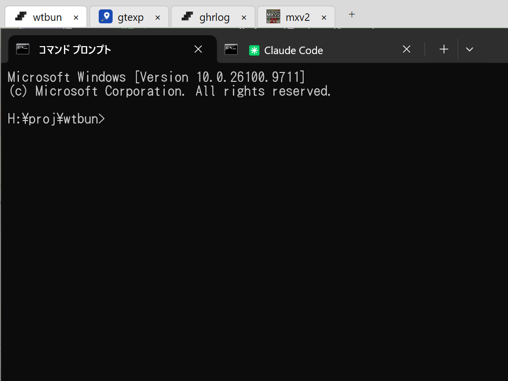

# wtbun - Windows Terminal Bundler



日本語 | [English](README.en.md)

## これはなに？

Windows Terminal は、複数のターミナルをタブで 1 つのウィンドウにまとめられます。wtbun は、この「タブでまとめたウィンドウ」を、さらにプロジェクトの数だけ束ねて管理する Windows 用のアプリです。

- プロジェクトのフォルダーを開くと、そのプロジェクト用の Windows Terminal のウィンドウを 1 つ開きます。開くタブは、プロジェクトごとの構成ファイルで決められます。
- wtbun はターミナルのウィンドウの真上に付く細いタブ列で、タブを選ぶとそのプロジェクトのウィンドウに切り替わります。
- すべてのプロジェクトのウィンドウは、同じ場所・同じ大きさにそろいます。1 つを動かしたり大きさを変えたりすると、ほかのウィンドウも同じになります。
- wtbun を終了するとプロジェクトのウィンドウもまとめて閉じ、次に起動すると前回のプロジェクトを開き直します。

本アプリは Microsoft とは関係のない個人のプロジェクトです。

## 必要なもの

- Windows 10 / 11
- [Windows Terminal](https://aka.ms/terminal)（1.24 で動作を確かめています）
- [.NET 10 デスクトップ ランタイム](https://dotnet.microsoft.com/download/dotnet/10.0)

## 使い方

### プロジェクトを開く

1. `Wtbun.exe` を起動すると、細いタブ列だけのウィンドウが出ます。
2. タブ列の「＋」を押して「フォルダーを選択…」を選び、プロジェクトのフォルダーを選びます。
3. そのプロジェクト用の Windows Terminal のウィンドウが開き、タブ列がその真上に付きます。

同じように「＋」で、いくつでもプロジェクトを開けます。すでに開いているフォルダーをもう一度選ぶと、「開き直す」（`.wtbun.toml` を読み直して開き直す。実行中のコマンドは終了します）、「前面に表示」（開いているウィンドウに切り替えるだけ）、「キャンセル」から選べます。

一度開いたフォルダーは、「＋」の「履歴」から選べます（新しい順に 20 件まで）。「履歴の消去…」では、無効になったフォルダー（フォルダーがなくなったか、`.wtbun.toml` がなくなったもの）だけか、すべてのフォルダーかを選んで、履歴から消去できます。

### プロジェクトを切り替える・並べ替える・閉じる

- **切り替え**：タブ列のタブを押すと、そのプロジェクトのウィンドウが前面に出ます。タスクバーなどから直接ウィンドウを選んでも、タブ列がそのウィンドウに付きます。
- **並べ替え**：タブをドラッグするか、タブを右クリックして「左へ移動」「右へ移動」を選びます。
- **閉じる**：タブの「×」を押すか、タブを右クリックして「閉じる」を選びます。Windows Terminal 側でウィンドウを閉じても、タブは自動で消えます。

### ウィンドウの位置と大きさ

- すべてのプロジェクトのウィンドウは、同じ場所・同じ大きさになります。前面のウィンドウを動かしたり大きさを変えたりすると、操作を終えたときにほかのウィンドウも同じになります。
- タブ列のタブがない所をドラッグすると、タブ列とすべてのウィンドウを一緒に動かせます。
- タブ列を置く場所を空けるため、ウィンドウを画面の上端に寄せると、タブ列の高さぶん下にずれます。
- 最大化すると、タブ列の下の画面いっぱいの大きさになります。もう一度最大化すると、元の大きさに戻ります。

### 終了と、次の起動

- タブ列の右端の「≡」から「wtbun を終了」を選ぶと、すべてのプロジェクトのウィンドウを左のタブから順に閉じて終了します。
- 次に起動すると、前回開いていたプロジェクトを、同じ並び・同じ位置で開き直します。
- タブが複数あるウィンドウは、閉じるときに Windows Terminal が確認を出します。確認は 1 つずつ出るので、答えると次のウィンドウに進みます。取り消したウィンドウは開いたまま残り、次に wtbun を起動したときにそのまま使われます。確認が要らなければ、Windows Terminal の設定で、複数のタブを閉じるときの確認をオフにしてください。

### 設定

タブ列の右端の「≡」から選びます。

- **環境設定…**：表示する言語（English・日本語）を選べます。選ぶとすぐに切り替わります。最初は Windows の表示言語に合わせます（日本語以外は English）。
- **ターミナルをタスクバーに表示**：オフにすると、プロジェクトのウィンドウをタスクバーに出さず、wtbun だけを出します。wtbun のボタンを押すと、選んでいるプロジェクトのウィンドウも見えるようになります。

### バージョン情報

タブ列の右端の「≡」から「wtbun について…」を選ぶと、バージョン、著作権表示、リリースのページ、ライセンス（NOTICE・LICENSE）を確認できます。「バージョン情報をコピー」で、アプリ名とバージョンをコピーできます。

## プロジェクトの構成ファイル

プロジェクトを開くと、プロジェクトのフォルダーの直下に `.wtbun.toml` を作ります（すでにあれば、それに従って開きます）。最初はタブ 1 つだけの構成です。開くタブを増やしたいときは、タブの右クリックの「プロジェクトの構成を編集…」を使うか、このファイルを書き換えます。最初に作るファイルには、各項目の説明と、タブを増やすときの例がコメントで入っています。コメントは、作るときの表示の言語で書きます。

タブには、プロジェクトのフォルダーの直下にある `.wtbun.ico` か `.wtbun.png`（この順に探します）をアイコンとして表示します。どちらもなければ wtbun のアイコンです。「プロジェクトの構成を編集…」の「インポート…」で画像を選ぶと、中央を正方形に切り抜いて `.wtbun.png` として保存します。

書き方は [TOML](https://toml.io/ja/) です。`[[tabs]]` の行から始めてタブを 1 つずつ書き、`#` から行末まではコメントです。値を `'…'`（単一引用符）で囲むと、Windows のパスやコマンドの `\` や `"` をそのまま書けます。

```toml
version = 1
name = 'My Project'

[[tabs]]
title = 'main'
dir = '.'

[[tabs]]
title = 'files'
dir = '.'
profile = 'Windows PowerShell'
command = 'powershell -NoExit -Command Get-ChildItem'

[[tabs.panes]]
split = 'right'
size = 0.4
command = 'npm run dev'
```

この例では、2 つ目のタブを Windows PowerShell のプロファイルで開き、フォルダーのファイルの一覧を表示して、そのままプロンプトで待ちます。さらにそのタブを右に分割し、4 割の幅のペインで `npm run dev` を実行します。

| 項目 | 内容 |
|---|---|
| `name` | wtbun のタブに出すプロジェクトの名前。省略するとフォルダーの名前。最初の `[[tabs]]` より前に書きます |
| `title` | タブのタイトル。省略すると Windows Terminal の既定 |
| `dir` | 開始フォルダー。相対パスはプロジェクトのフォルダーが基準 |
| `command` | タブで実行するコマンド。省略するとプロファイルの既定（シェル）。`npm` のようなバッチファイル（`.cmd`・`.bat`）もそのまま書けます。コマンドが終わるとタブも閉じるので、閉じたくないときは前に `cmd /k`（PowerShell なら `powershell -NoExit -Command`）を付けます |
| `profile` | Windows Terminal のプロファイル名（Windows Terminal の設定に出ている名前）。省略すると既定のプロファイル |
| `append_command_line` | `true` にすると、`command` をプロファイルのコマンドの後ろに追加します（`command` にはプロファイルのコマンドに渡す引数を書きます） |
| `tab_color` | タブの色。`'#RRGGBB'` か `'#RGB'`。省略するとプロファイルの設定 |
| `color_scheme` | 配色の名前（例：`'One Half Dark'`）。省略するとプロファイルの設定 |
| `suppress_application_title` | `true` にすると、実行中のプログラムがタブのタイトルを変更できません。`false` にすると変更できます。省略するとプロファイルの設定 |
| `inherit_environment` | `true` にすると Windows Terminal の環境変数を引き継ぎ、`false` にすると新しく読み込みます。省略すると、`command` があるときは引き継ぎます |
| `selected` | `true` にすると、開いたときにこのタブを選びます。1 つのタブにだけ書けます。省略すると最後のタブ |

タブを分割するには、`[[tabs]]` の後ろに `[[tabs.panes]]` を書きます。書いた順に、直前のペインを分割します。`[[tabs.panes]]` には、上の表の項目（`title` から `inherit_environment` まで）と、次の項目を書けます。

| 項目 | 内容 |
|---|---|
| `split` | 新しいペインを置く向き。`'right'`（右）か `'down'`（下）。省略すると縦横の長さで決まります |
| `size` | 新しいペインの大きさ。分割する前のペインに対する割合を、`0.4` のように 0 より大きく 1 より小さい数で書きます。省略すると半分 |
| `duplicate` | `true` にすると、直前のペインと同じプロファイルとフォルダーで開きます |
| `selected` | `true` にすると、開いたときにタブの中でこのペインを選びます。1 つのタブで 1 つのペインにだけ書けます。省略すると最初のペイン（`[[tabs]]` で開いたもの） |

タブには、選ばれているペインのタイトルが表示されます。

### コマンドを起動する

たとえば `command = 'ssh 接続先'` と書くと、プロジェクトを開いたときにsshで指定した接続先に接続するようにすることができます。

また `command = 'npm run dev'` と書くと、プロジェクトを開いたときに開発用のサーバーを起動しておけます（そのフォルダーに `package.json` があり、`dev` のスクリプトが定義されている場合）。

#### ssh 接続用プロファイルで接続して、接続先の指定したフォルダーでシェルを開く

ssh で接続するWindows ターミナルのプロファイル（たとえばコマンドラインが `ssh.exe myserver` の「myserver」）を作ってある場合は、そのプロファイルにコマンドを追加する形でも書けます。

```toml
[[tabs]]
title = 'server'
profile = 'myserver'
command = '-t "cd ~/work/project && exec $SHELL -l"'
append_command_line = true
```

書き方のポイントは次の 2 つです。

- `-t` を付けます。ssh は後ろにコマンドがあると端末を割り当てないので、`-t` がないとプロンプトの出ないシェルが開きます
- 接続先で実行する部分は、`"…"` で 1 つにまとめます。ssh は引数を空白でつないで接続先に送るので、`zsh -c "…"` のように引用符の中に引用符を入れる書き方では、接続先で区切りが崩れます

#### wtbunプロジェクト保存用のローカルフォルダーを作る

ssh で使う場合、実際に作業するフォルダーは接続先にありますが、wtbun でプロジェクトとして開くには、`.wtbun.toml` を置くローカルのフォルダーが必要です。そこで、ローカルのホームフォルダーに、接続先のプロジェクトごとのフォルダーを作っておくと便利です。

```
%USERPROFILE%\wtbun\
├─ myserver-project\     ← 「＋」でこのフォルダーを開く
│   ├─ .wtbun.toml       ← ssh で接続先の ~/work/project を開く構成
│   └─ .wtbun.png        ← タブのアイコン（なくてもかまいません）
└─ otherserver-tools\
    └─ .wtbun.toml
```

- フォルダー名は、wtbun のタブに表示する名前にもなります（`name` を書かない場合）
- ローカルのフォルダーの中身は使わないので、`.wtbun.toml` だけを置けば十分です

`.wtbun.toml` は「開くときの構成」です。開いた後に Windows Terminal で増やしたタブは、このファイルには反映されません。書き方の誤りや、書き間違えた項目名があるときは、その行や項目名をメッセージでお知らせします。

### 気をつけること

- Windows Terminal の設定で、起動時に前回のウィンドウを復元するようにしていると、wtbun の開き直しと重なってウィンドウが二重に開くことがあります。wtbun を使うときは、この設定をオフにしてください。
- 「＋」でプロジェクトを開いている最中に、別の Windows Terminal のウィンドウを開くと、そちらをプロジェクトのウィンドウと取り違えることがあります。

## 手元で動かす（開発）

.NET 10 SDK が必要です。Visual Studio の C++ ツールがあると、タスクバーから閉じるときの確認に使う `wtbunhook.dll`（x64）も一緒にビルドします。なければ警告が出て、この確認だけが働きません。仕様は [memo/doc/spec.md](memo/doc/spec.md)、設計方針は [memo/doc/design.md](memo/doc/design.md) にあります。

```sh
dotnet build wtbun.slnx              # ビルド
dotnet run --project src/Wtbun       # 起動
```

`wtbun.slnx` を Visual Studio で開いて実行することもできます。

試しに動かすときに、ふだん使っている wtbun の状態（開いていたプロジェクトと設定）を使いたくなければ、`--data-dir` で別の保存先のフォルダーを指定します。

```sh
dotnet run --project src/Wtbun -- --data-dir C:\temp\wtbun-test
```

表示する言語を、設定を変えずにその起動の間だけ変えるには、`--lang` に `en-US` か `ja-JP` を指定します。

```sh
dotnet run --project src/Wtbun -- --lang en-US
```

リリース用にビルドすると、`src/Wtbun/bin/Release/net10.0-windows/Wtbun.exe` ができます。

```sh
dotnet build wtbun.slnx -c Release
```

配布用のパッケージは、リポジトリ直下の `release.cmd` で作ります。`release/wtbun_（バージョン）/` にリリース版の実行ファイルと README.md・README.en.md・LICENSE・NOTICE を入れ、そのフォルダーごと `release/wtbun_（バージョン）.zip` にまとめます。`wtbunhook.dll` も入れるので、Visual Studio の C++ ツールが必要です。

```sh
release.cmd
```

## 構成

| 場所 | 中身 |
|---|---|
| `src/Wtbun/` | アプリ本体（C# / WPF） |
| `src/Wtbun/Config/` | 構成ファイル `.wtbun.toml`・保存した状態・設定の読み書き |
| `src/Wtbun/Localization/` | 画面の文言（`Strings.resx` が英語、`Strings.ja.resx` が日本語）と、言語の切り替え |
| `src/Wtbun/Terminal/` | Windows Terminal のウィンドウを開く・探す・閉じる |
| `src/Wtbun/Layout/` | ウィンドウの位置と大きさをそろえる |
| `src/Wtbun/Native/` | Win32 API の呼び出し（ウィンドウの操作・監視、タスクバー） |
| `Directory.Build.props`・`Directory.Build.targets` | ビルド時に Profile.ini を読み、バージョン情報と定数を作る |
| `Profile.ini` | アプリ名・バージョン・著作権表示などの定数定義 |
| `memo/doc/` | 設計方針・仕様などの文書 |
| `memo/log/` | 作業ログ（`YYYYMMDD.md`） |

ビルド出力の `bin/`・`obj/` は Git の管理対象外（`.gitignore` 適用済み）です。

wtbun は、開いていたプロジェクトと設定を `%APPDATA%\wtbun\` に保存します（`state.json`・`settings.json`）。

## 著作権表記

Copyright (C) 2026 GORRY. \
本パッケージは Apache License 2.0（LICENSE ファイル）のもとで利用・改変・再配布できます。著作権と第三者の表示は NOTICEファイルを参照してください。

## 連絡先

https://github.com/gorry/wtbun

## [EOF]
